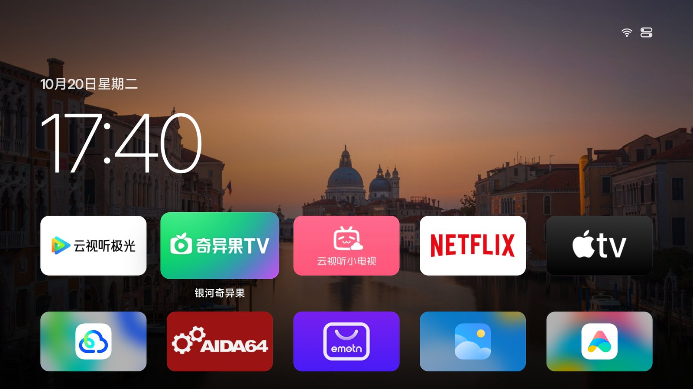
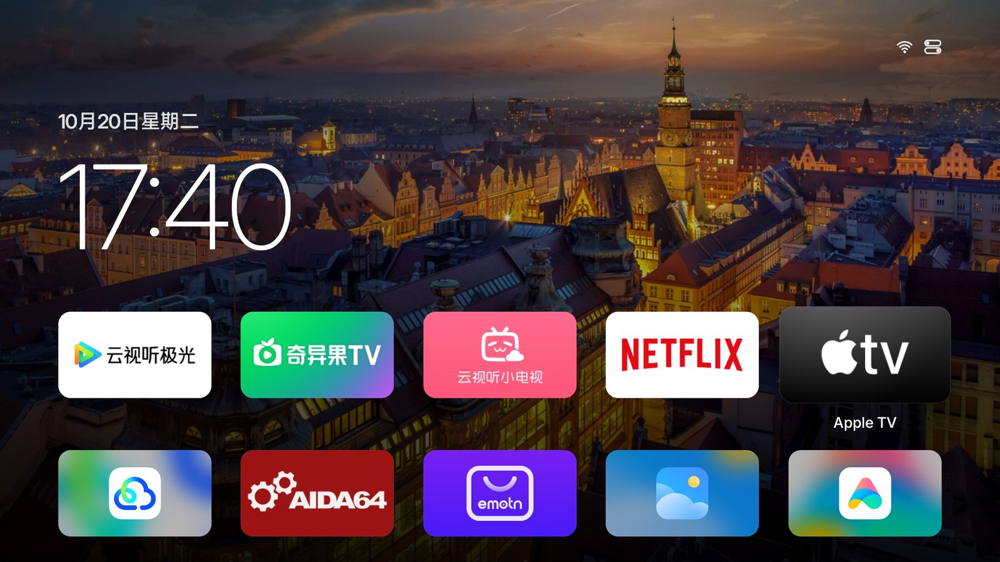
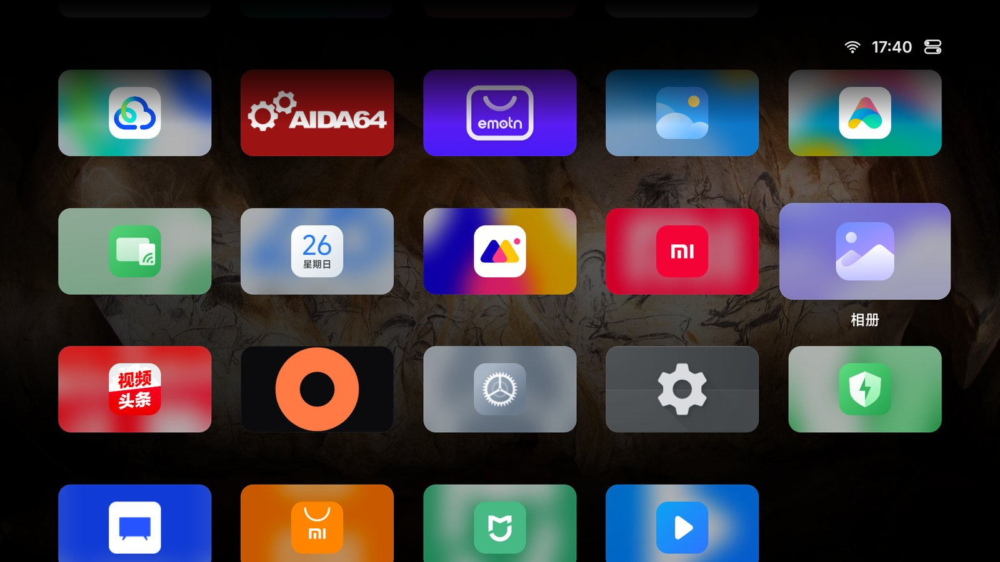
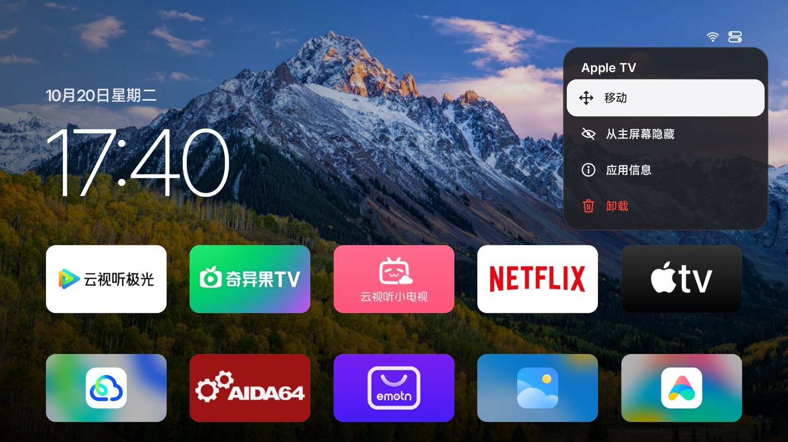
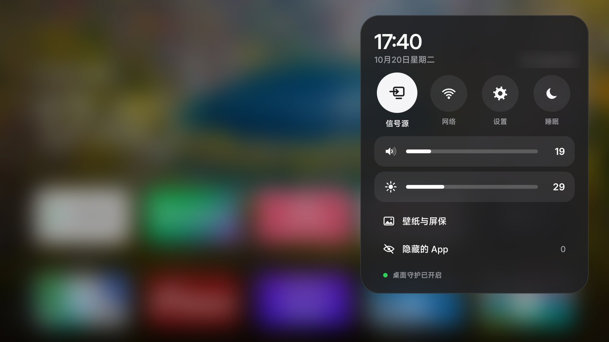
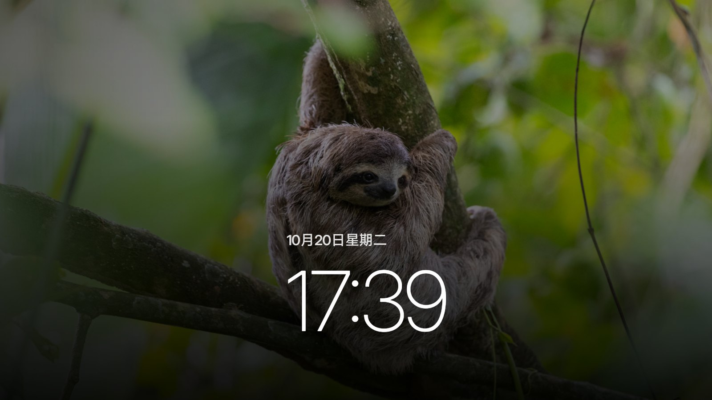
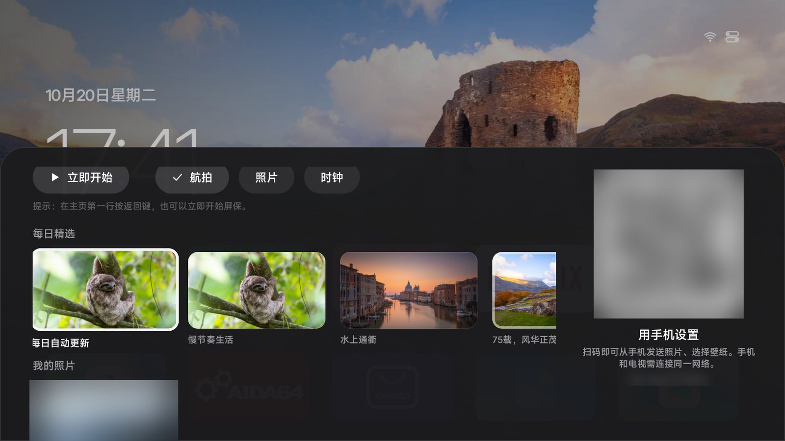
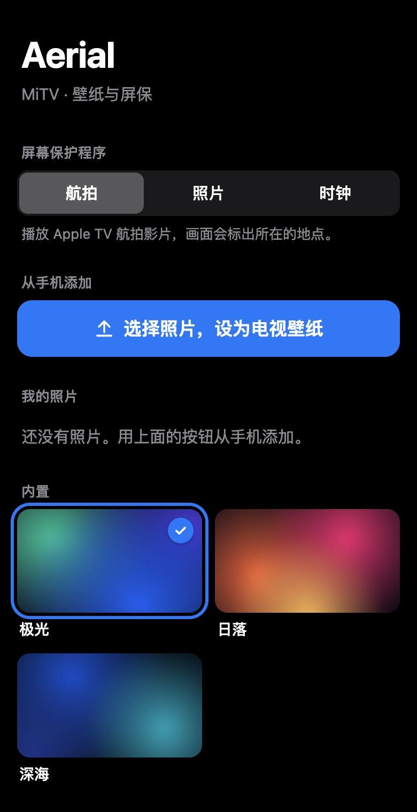

<div align="center">


# Aerial

**A calm home screen for Android TV.**

A tvOS-style launcher with no ads and no recommendation feeds. Just your apps, your wallpaper and Apple TV's aerial screensavers.<br>
Built for the Xiaomi, TCL and other TVs sold in China. It takes over at boot and survives standby.

[中文](README.md) · **English**

<a href="https://aerial.qust.me/en/"></a>
<a href="https://github.com/pengchujin/aerial-tv/releases/latest"></a>
<a href="#install-with-an-agent-recommended"></a>
<a href="#step-1-turn-on-adb-debugging"></a>

<a href="https://github.com/pengchujin/aerial-tv/releases/latest"></a>
<a href="LICENSE"></a>




| The TV's stock home screen | With Aerial |
|:---:|:---:|
|  |  |

</div>

## Features

### Home

<p align="center">
  
  
</p>

- **Clock**: a large, thin clock over your wallpaper, which darkens toward the bottom and left so everything stays readable. Scroll down and it tucks into the status bar.
- **App grid**: five apps per row. The focused app lifts and shows its name, with a white ring so you can spot it from the couch. Prefer the plain tvOS look? Set Focus Style to Standard in Control Center → Personalize.
- **Icons**: apps with a TV banner show it. Square icons fill the tile with their own color, and adaptive icons split into layers for a parallax effect.
- **Every app**: including system apps with no launcher entry, like Xiaomi's App Store, Media Player and Mi Home.
- **Input tiles**: pin HDMI, AV or the antenna to Home and switch to it in one press (Control Center → Inputs → Show on Home).
- **Back button**: works like tvOS. In the grid it jumps to the top row; on the top row it starts the screensaver.

### Long press



Hold OK to **Move** (other tiles make room), **Hide from Home**, open **App Info** or **Uninstall**.

### Control Center



Press Up from the top row to reach the top right, then OK (once there, the menu button ≡ opens it too). You get inputs (with HDMI-CEC devices), network and settings, volume and brightness sliders, plus Personalize (wallpaper, screensaver, focus style, weather) and Hidden Apps. Network and settings open your TV's own panels. On an app, the menu button opens that app's menu (move, hide and so on), the same as holding OK.

### Screensaver

<p align="center">
  
  
</p>

- **Aerial**: 114 aerial films from Apple TV, streamed from Apple's servers, with location names as the camera moves. Left and right skip between films.
- **Photos**: the daily photos and your own, slowly panning.
- **Clock**: moves every minute to prevent burn-in.

On TVs that use Android's standard screensaver (TCL, for one), Aerial becomes the system screensaver. Xiaomi uses its own, so Aerial starts first whenever Home sits idle, ahead of Xiaomi's ad-filled one.

### Wallpaper and phone setup

<p align="center">
  
  
</p>

- **Wallpaper**: Bing's photo of the day, eight built-in gradients, or your own photos.
- **Phone setup**: scan the QR code in the wallpaper panel to upload photos, pick a wallpaper or change the screensaver from your phone. The page is only open while the panel is, behind a random token.

## Install

No root, no changes to system apps, and you can undo it any time. Put your computer and TV on the same network; it takes two steps.

### 1. Turn on ADB debugging

Chinese firmware shows its menu names in Chinese; they're in brackets.

| TV | How |
|---|---|
| **Xiaomi / Redmi** | Settings (设置) → About (关于) → press OK on **Model** (产品型号) until developer mode is on. Then Settings → Account & Security (账号与安全): turn on **ADB debugging** (ADB 调试) and **Install unknown apps** (安装未知来源的应用) |
| **TCL / FFALCON** | Settings (设置) → About (关于) → **Device info** (本机信息), then quickly press **Up, Down, Left, Right**. Turn on **ADB** in the **More** (更多) group that appears |
| **Other Android TVs** | Settings → Device Preferences → About → press **Build** (not Android version) 7 times, then turn on **USB debugging** in Developer options |

The TV's IP address is under Settings → Network. The first time your computer connects, the TV asks to allow debugging: choose **Always allow**.

### 2. Install (pick one)

**With an agent (recommended)**: paste this into an agent that can run commands on your computer, such as:

 Claude Code &nbsp;  Codex &nbsp;  WorkBuddy &nbsp;  Trae &nbsp; or Cursor

```text
Please install Aerial, an open-source home screen for Android TV, on my TV, and make it the home screen the TV starts into.
TV IP address: <TV-IP>
Keep ADB debugging on: yes

The install guide is here: https://aerial.qust.me/en/agent.md
(If you can't open it, use https://raw.githubusercontent.com/pengchujin/aerial-tv/main/site/en/agent.md)

Read the whole guide before you start. Then run the commands yourself on my computer; don't just tell me the steps. Tell me when I need to do something on the TV.
At the end, paste the raw output of the commands under "Check" in the guide.
```

Phone apps and web chats only tell you the steps; they can't install it. When the agent says it's done, check that the last output it pasted includes `app.orchard.tv`. If it doesn't, it isn't installed.

**One command (macOS / Linux)**:

```bash
curl -fsSL https://aerial.qust.me/install.sh | KEEP_ADB=1 TV=192.168.1.20 bash
```

**Manual**: download [aerial-standard.apk](https://aerial.qust.me/download/aerial-standard.apk) (also on [GitHub](https://github.com/pengchujin/aerial-tv/releases/latest)), then:

```bash
adb connect 192.168.1.20:5555
adb install -r aerial-standard.apk
adb shell pm grant app.orchard.tv android.permission.WRITE_SECURE_SETTINGS
adb shell cmd notification allow_listener app.orchard.tv/app.orchard.tv.guard.RevivalListener
adb shell appops set app.orchard.tv SYSTEM_ALERT_WINDOW allow
adb shell am start -n app.orchard.tv/.MainActivity
```

On Windows, use an agent, or run the Windows steps in the [install guide](site/en/agent.md) one by one.

### Undo

```bash
curl -fsSL https://aerial.qust.me/install.sh | TV=192.168.1.20 bash -s restore
```

If an agent installed it, tell the agent:

```text
Please follow the "Undo" section of https://aerial.qust.me/en/agent.md to give my TV (IP address: <TV-IP>) its original home screen back, without uninstalling Aerial. Run the commands yourself on my computer, and at the end paste the raw output of adb shell "dumpsys window | grep mCurrentFocus".
```

### Troubleshooting

- **TCL shows a 多屏互动 (screen sharing) prompt**: TCL blocks ADB installs, so the script pushes the APK through that service. Press Right, then OK, to choose 同意 (Agree).
- **Firmware won't install home-screen apps**: add `-s guard` to the end of the command, or install [aerial-guard.apk](https://aerial.qust.me/download/aerial-guard.apk) by hand.
- **What `KEEP_ADB=1` does**: Xiaomi turns ADB off when it wakes; with this, Aerial turns it straight back on. Leave it out if you don't need it.
- **Do my apps, subscriptions and old home screen stay?** Yes. The old home screen stays in the app list. A boot ad is played by the firmware, so it stays too.
- **Updating**: run the install command again, or ask the agent to install it again.
- **Not supported**: LG webOS, Samsung Tizen, Huawei Vision (HarmonyOS), Android 4.4 or older.

## How it stays your home screen

Most TVs sold in China only accept the maker's launcher and kill other apps in standby. Aerial tries the polite way first:

1. **Ask nicely**: request the Home role and become the default launcher. On stock Android TV and Google TV, that's all it takes.
2. **Home Guard**: when the firmware insists on its own launcher (Xiaomi and TCL both do), an accessibility service brings Aerial back the moment the stock launcher comes to the front. It only sees which window is in front, never what's on screen.
3. **Come back after being killed**: Xiaomi force-stops every third-party app in standby. Aerial registers a notification listener (it reads no notifications), which Android rebinds within about half a second. That restarts Aerial, which then turns Home Guard back on with `WRITE_SECURE_SETTINGS`.
4. **Start at boot**: Android binds the notification listener at boot, which starts Aerial. TCL also blocks third-party apps from starting at boot; the installer allows Aerial through with `appops`.
5. **Keep ADB on** (optional): Xiaomi turns ADB debugging off on wake. With `KEEP_ADB`, Aerial turns it back on so future updates just work.

### Permissions granted over ADB

| Permission | Why |
|---|---|
| `WRITE_SECURE_SETTINGS` | Turn Home Guard back on after the system switches it off; keep Aerial as the system screensaver; `KEEP_ADB`; set the backlight on Xiaomi |
| Notification listener | Lets Android restart Aerial after it's force-stopped or the TV boots. No notifications are read |
| Display over other apps (`SYSTEM_ALERT_WINDOW`) | Open Aerial from the background at boot |
| Modify system settings | Adjust brightness through the standard API |
| Location | Only used to read the Wi-Fi network name |
| TCL `APP_AUTO_START` / `APP_ASSOC_START` | Allow starting at boot (TCL only) |

## Tested TVs

| Model | System | Status | Notes |
|---|---|---|---|
| Xiaomi MiTV-MFTR0 | Android 14 / HyperOS TV | In daily use | [Notes](docs/devices/xiaomi-mitv-mftr0.md) (Chinese) |
| Xiaomi MiTV-MFFU0 | Android 14 / HyperOS TV | Install and boot verified | [Notes](docs/devices/xiaomi-mitv-mffu0.md) (Chinese) |
| Redmi X65 2026 (MiTV-MFTR0) | Android 14 / HyperOS TV | User-verified: install, starts into Aerial after reboot ([#3](https://github.com/pengchujin/aerial-tv/issues/3)) | Same as MiTV-MFTR0 |
| TCL MT5879 (China) | Android 11 | In daily use | [Notes](docs/devices/tcl-mt5879-cn.md) (Chinese) |
| Sony XRJ-77A80J (China, BRAVIA VH2) | Android 10 | User-verified: install, boot, wake from standby, screensaver ([#16](https://github.com/pengchujin/aerial-tv/issues/16)) | — |
| Sony BRAVIA VH1 (China) | Android 12 | User-verified; brightness opens Sony's picture settings ([#2](https://github.com/pengchujin/aerial-tv/issues/2)) | — |
| Skyworth Coolita K3 Pro 90P3D Max (8R145) | Android 11 | User-verified: starts into Aerial at boot ([#43](https://github.com/pengchujin/aerial-tv/issues/43)). From 1.15 there is no need to avoid making Aerial the default Home | — |
| Konka 2861 | Android 5.1.1 | User-verified: installs ([#37](https://github.com/pengchujin/aerial-tv/issues/37)) | — |
| PPTV K55U27 | Android 6 | User-verified: works ([#39](https://github.com/pengchujin/aerial-tv/issues/39)) | — |
| Tencent Aurora Box 7S | — | User-verified: installs; two Settings tiles (hide one with a long press); back to the stock launcher after standby, open ([#51](https://github.com/pengchujin/aerial-tv/issues/51)) | — |
| Xiaomi MiTV-ASTP0 | Android 9 | User-verified: install, boot, wake from standby; Home flashes the stock launcher first ([#48](https://github.com/pengchujin/aerial-tv/issues/48)) | — |
| Xiaomi MiTV-NSOP0 | Android 9 | User-verified: one-line install, boot ([#65](https://github.com/pengchujin/aerial-tv/issues/65)) | — |
| XGIMI projector (m7642) | Android 9 | User-verified: boot; Home after a video sometimes hangs, open ([#44](https://github.com/pengchujin/aerial-tv/issues/44)) | — |
| TCL 55S595C Ultra (MT9655) | Android 11 | Installs, but ADB is wireless debugging only with no way to authorize, so Home cannot be taken over ([#52](https://github.com/pengchujin/aerial-tv/issues/52)) | [Notes](docs/devices/tcl-mt9655-cn.md) (Chinese) |

### Reported by users (no logs, unverified)

From Weibo comments ([#33](https://github.com/pengchujin/aerial-tv/issues/33)); people said it installed, without model details or logs: Xiaomi TV S Pro Mini LED 2026, Xiaomi TV 4A (Android 6), Mi Box 5, Xiaomi monitor / G Pro, Redmi TV, Redmi Projector 5 Pro, Sony A8G / X9000H / X90J, TCL 75Q10G Pro, Thunderbird Peng 6SE, OPPO S1, an old Sharp, Dangbei F5 projector, Amazon Fire TV.

Installs but does not start into Aerial: Vidda, Hisense (only by deleting the stock launcher, which Aerial will not do), OPPO K9, Thunderbird He 6 2025 Ultra.

[Open an issue](https://github.com/pengchujin/aerial-tv/issues) or send a PR to add yours; the output of `getprop ro.product.model` and of the installer helps most.

## Known limitations

- **Needs internet**: aerial films stream at 1080p H.264, about 15–20 Mbps. The daily photos need a connection too.
- **HDMI device names**: reading a device's real name (like "Apple TV") needs system permissions, so inputs only show "Connected".
- **TCL volume bar**: TCL shows its own volume bar when Aerial changes the volume. That's what makes the change actually reach the speakers.
- **Xiaomi screensaver**: if the TV sits idle in another app, Xiaomi's own screensaver still appears.
- **No web installer**: browsers can't reach the TV's ADB port, and a TV's USB port can't act as a device for your computer, so there's no install-from-a-web-page option.

## Development

Requires JDK 17 and Android SDK 36.

```bash
./gradlew assembleStandardRelease assembleGuardRelease
BUILD=1 KEEP_ADB=1 TV=<TV-IP> tools/install.sh      # install the APK you just built
```

Developer docs are in Chinese:

- [docs/ARCHITECTURE.md](docs/ARCHITECTURE.md): code structure and data flow
- [docs/HANDOFF.md](docs/HANDOFF.md): current status, debugging tips, rules to follow
- [docs/devices/](docs/devices/): per-model notes, including TCL's screen-sharing push protocol
- [AGENTS.md](AGENTS.md): notes for AI coding agents
- [site/](site/): the website (static; Chinese at `/`, English at `/en/`)

A few design choices: everything is laid out on a 960×540dp canvas and scaled, so TVs with different densities look identical. TV GPUs are weak, so each frame draws at most one full-screen layer and nothing animates while idle. Focus animations use springs, so they can be interrupted. The typeface is Inter (OFL).

The aerial catalog, `app/src/main/assets/aerials.json`, is generated from Apple's public `resources-16.tar`. It holds film addresses and location names only, no video.

## License

[MIT](LICENSE). The Inter typeface is under the [SIL Open Font License](FONT-LICENSE-OFL.txt).

Aerial is an independent open-source project, not affiliated with Apple, Xiaomi, TCL or Sony. The aerial films are © Apple and stream from Apple's servers. Daily photos come from Bing and belong to their respective owners.
